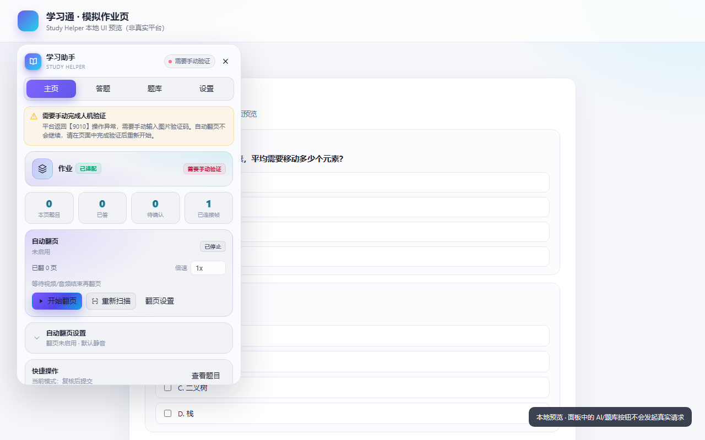

# 学习助手 · Study Helper

一个 Tampermonkey 用户脚本：在学习通（超星）等在线学习平台页面注入现代化悬浮面板，提供 **自动翻页**、**题目识别与作答**、**本地题库检索**、**AI 解题（OpenAI 兼容 API）**，并支持「仅提示 / 复核后提交 / 全自动」三种模式。


> 默认人工复核；考试页默认禁用；不伪造视频进度、不绕过验证码、不做反检测。请遵守学校与平台规则，风险自负。

## 功能

- **自动翻页**：章节顺序、知识卡片、答题分页；视频/音频播完再翻页；播放器结束后立即循环也能识别；当前章节任务点全部完成时跳过等待；任务点切换时清空旧媒体状态；点击后校验任务点/页面确实变化，未变化会暂停而不是重复执行；需要鼠标焦点的播放器会先聚焦视频再恢复播放；视频暂停且无法自动恢复时等待手动播放而不是直接停止；停止自动翻页会自动暂停当前视频/音频。重复页面/无按钮/等待超时自动停止。翻页延迟与最大步数使用内置安全默认值，界面只保留开关。
- **多任务点顺序播放**：同页存在多个视频任务点时，按任务点 DOM 顺序从上到下逐个播放；跳过 `.ans-job-finished` 已完成任务点；同一时间只恢复当前任务点的视频，其他任务点暂停，避免多个视频同时播放、互相抢进度或来回切换。
- **字体反爬解码**：自动解析学习通 `font-cxsecret` 加密字体，把题干/选项还原为正常文字后再送题库与 AI，减少因乱码导致的低置信度答案。
- **视频/音频**：默认静音；倍速在主页「自动翻页」卡片调节（默认 1x，跨 frame 同步，播放器重置后自动补回）；自动翻页时暂停后恢复。自动翻页运行期间有「播放保活守卫」：平台/失焦导致的暂停会自动恢复，用户主动暂停和脚本自身暂停不会被抢；恢复后只记录进度停滞/跳变，不 seek、不改进度。默认静音只应用一次，手动静音不会被覆盖；不伪造进度。
- **题目采集**：单选、多选、判断、填空、简答；选项乱序也能按文本匹配。
- **本地题库**：JSON / CSV / TSV / TXT 导入，精确 + 模糊检索，IndexedDB 存储，解题缓存。
- **AI 解题**：OpenAI 兼容 `/chat/completions`，预置 DeepSeek / OpenAI / 硅基流动，支持自定义 Base URL、模型与批量大小。
- **悬浮 UI**：Shadow DOM 隔离、深/浅色、拖拽、快捷键 `Alt+Shift+S`、题目复核、设置随功能就近展开、内嵌运行日志与导出、一键复制脱敏诊断包。答题/AI 设置在「答题」，翻页/媒体设置在「主页」，题库设置在「题库」，「设置」只保留外观、高级、数据与日志。
- **多标签互斥**：同一门课程同时只允许一个标签页自动翻页；第二个标签页会被拒绝启动，持有者崩溃/关闭后 15 秒可自动接管。
- **安全默认**：复核后提交；低置信度标黄；考试页需二次确认；仅提示模式禁止提交；提交前校验「已填入」覆盖率；API Key 仅存本机并脱敏。

## 安装

```bash
npm install
npm run build
```

构建产物：`dist/study-helper.user.js`。

1. 安装 [Tampermonkey](https://www.tampermonkey.net/)（Chrome / Edge / Firefox）。
2. 打开 Tampermonkey 管理面板 → 实用工具 → 从文件导入 `dist/study-helper.user.js`。
3. 打开学习通页面，右下角出现悬浮球；点击或按 `Alt+Shift+S` 展开。

开发调试：

```bash
npm run dev          # Vite 开发服务器 + 用户脚本注入
npm test             # 单元 / DOM / 集成测试
npm run test:sandbox # 受限 Windows 沙箱内的测试 workaround
npm run typecheck    # TypeScript
```

构建后可打开 `dev/preview.html` 查看本地模拟作业页与悬浮面板（直接以 `file://` 打开即可，不需要真实账号）。

### 接入其他平台

首版 `@match` 只包含学习通。若要适配其他平台：

1. 在 `vite.config.ts` 的 `userscript.match` 里加入目标域名（例如 `*://*.example.com/*`），重新构建并安装；
2. 在面板 **设置 → 高级与通用适配器** 填入选择器 JSON，例如：

```json
{
  "name": "作业",
  "matches": ["example.com"],
  "questionContainer": ".question",
  "stem": ".stem",
  "options": ".option",
  "typeLabel": ".type",
  "nextButton": ".next",
  "submitButton": ".submit"
}
```

3. 保存后刷新页面。通用适配器是实验性能力，复杂页面仍建议实现专用 `PlatformAdapter`。

## 快速开始

1. 打开面板 → **答题** → **AI 接口**，填写 Base URL、API Key、模型，点「测试连接」。
2. 选择答题模式（**答题** → **答题设置**）：
   - **仅提示**：只显示答案，不操作页面；
   - **复核后提交**（默认）：自动填入，人工核对后提交；
   - **全自动**：自动填入并提交；低置信度题会暂停。
3. **题库** → 导入已有题库（可选，但强烈推荐，快且省钱）。
4. 打开作业/章节测验页面 → **答题** → **开始解题** → 核对 → **全部填入** → **提交**。
5. 章节页 → **主页** → **开始翻页**；倍速在同一张「自动翻页」卡片里调整，翻页规则与媒体偏好在同页的「自动翻页设置」中展开。

## 题库格式

示例见 [`examples/questions.sample.csv`](examples/questions.sample.csv)。

### CSV / TSV

```csv
type,question,optionA,optionB,optionC,optionD,answer,source
single,下列哪个是质数？,2,4,6,8,A,自建题库
multiple,以下属于编程语言的有？,Python,HTML,Java,CSS,"A,C",自建题库
judge,地球是圆的。,正确,错误,,,对,自建题库
fill,中国的首都是____。,北京,,,,,北京,自建题库
```

也支持通用列：

```csv
type,question,options,answer,source
single,下列哪个是质数？,"2|4|6|8",A,自建题库
```

### JSON

```json
[
  {
    "type": "single",
    "question": "下列哪个是质数？",
    "options": ["2", "4", "6", "8"],
    "answer": "A",
    "source": "自建题库"
  },
  {
    "type": "judge",
    "question": "地球是圆的。",
    "answer": "对"
  }
]
```

### TXT

每行 `题干<TAB>答案` 或 `题干==答案`。

### 答案写法

- 选择题：`A`、`AC`、`A,C`、`A、C`，或选项全文；
- 判断题：`对/错`、`正确/错误`、`√/×`、`T/F`、`true/false`；
- 填空题：多个空用 `|`、`；`、`;` 或换行分隔；
- 简答题：直接写文本。

`.xlsx` 请先另存为 CSV（UTF-8）。

## 远程题库（可选）

在 **题库 → 题库设置** 中启用后，脚本会向配置的 URL 发送：

```json
{
  "question": "题干",
  "type": "single",
  "options": [{ "key": "A", "text": "选项 1" }]
}
```

期望响应：

```json
{ "answer": ["A"], "confidence": 0.92 }
```

`answerPath` / `confidencePath` 支持点路径（如 `data.answer`）。没有内置任何第三方题库密钥；接口失败会自动回退 AI。

## 诊断与反馈

真实学习通页面的 DOM 会随版本变化。遇到「识别不到题目 / 翻页按钮找不到 / 视频一直等待」时：

1. 打开面板 → **设置** → **运行日志** → **复制诊断包**；
2. 把复制到的 JSON 贴到 issue 或反馈中。

诊断包只包含：脚本版本、页面类型与原因、frame 摘要、题目数量/题型/题干样本（截断 40 字、最多 10 条、不含答案）、选择器命中矩阵、媒体/翻页状态、脱敏设置（API Key 只显示「已设置/未设置」，请求头值全部替换为 `<redacted>`）、最近 100 条日志（再次脱敏）。页面 URL 只保留 pathname 与课程/章节相关白名单参数，不包含 token / share / signed 等敏感查询参数。

## 验证码与【9010】操作异常

学习通在请求过快、连续跳转章节或频繁操作时，可能返回「【9010】操作异常，请输入图片中的验证码」。

脚本不会识别、不会绕过验证码。检测到验证页后会自动：

- 立即暂停自动翻页，阻止继续点击下一页；
- 暂停当前视频/音频；
- 在面板顶部持续显示「需要手动完成人机验证」，日志记录 `[verify]`。

处理方式：在页面上手动输入验证码并提交 → 回到学习页面 → 重新点「开始翻页」。如果频繁出现，建议放慢操作、不要连续快速跳过大量已完成章节，或先休息几分钟再继续。



## 支持的页面

| 页面 | 能力 |
| --- | --- |
| `/mycourse/studentstudy` 章节学习 | 自动翻页、恢复 |
| `/knowledge/cards` 知识卡片 | 卡片内翻页、视频等待 |
| `ananas/modules/video/` 视频 | 等待播放结束 |
| `/work/doHomeWorkNew` 等作业页 | 采集、填答、提交 |
| `/exam-ans/exam/test/...` 考试 | 采集/填答/提交（默认禁用） |

选择器采用「候选数组 + 文本兜底」，但学习通多版本 DOM 可能存在差异。若识别失败：打开面板 **设置 → 运行日志** 查看 `scan` / `platform` 记录；面板中的「复制页面结构」能力可在后续版本补充。

## 安全与隐私

- API Key 只保存在 Tampermonkey 的 GM storage / 本机 localStorage，不会上传到任何自建服务器。
- 日志会自动脱敏 `sk-*`、`Authorization`、`apiKey` 字段。
- 题库与缓存保存在本机 IndexedDB；清除浏览器数据会一并删除。
- 除用户配置的 AI / 远程题库地址外，不发送任何请求；无遥测。
- 默认「复核后提交」；考试页需在「答题 → 答题设置」中二次确认开启；不实现验证码绕过、视频进度伪造、反检测。

## 已知限制

- 首版仅适配学习通；其他平台可通过 `advanced.genericConfig` 配置通用适配器（实验性）。
- 含图片/公式的题目默认转人工；纯文本模型无法可靠读图。
- 视频/音频只做「播放结束后翻页」，不做秒过/进度伪造；播放保活只在自动翻页运行期间生效，且尊重用户主动暂停。
- 浏览器可能拒绝自动播放；被拦截时会暂停并提示手动播放。
- 非标准播放器（把 video 放在 closed Shadow DOM 或使用 Canvas 播放）无法保证静音/倍速生效；普通 `<video>` / `<audio>` 或开放 Shadow DOM 可以。
- 文档/PPT/阅读页没有音视频元素时，按内置默认等待时长（约 3 秒）处理；不会自动滚动或代读。
- 提交按钮与确认弹窗因页面版本而异；若返回「提交状态未知」，请人工确认，脚本不会重复提交。
- 0.2.0 的 DOM 选择器基于公开结构与 fixture 测试，仍需在真实账号页面回归验证。
- 自动翻页点击后会等待任务点/页面变化；若平台任务点切换不改变 URL、frame 或当前章节文本，会判定为“未变化”并暂停，避免重复执行同一任务点（可在日志中查看翻页前后的任务签名）。
- 单个视频页仍按主播放器等待；同页多任务点优先按任务点顺序播放。若平台 DOM 变化导致任务点无法识别，会回退到通用媒体等待。
- 字体反爬解码依赖内置字形映射表；如果学习通更新字体导致仍出现乱码，需要更新 `src/platform/chaoxing/font/table.json`（该表来源许可未明确声明，见 THIRD_PARTY_NOTICES）。
- 多标签互斥基于 localStorage 心跳（15 秒过期）；隐私模式下存储不可用时以「拒绝启动」处理，不会退化成一页多开。
- 播放保活只处理当前文档与开放 Shadow DOM；跨域播放器由该 iframe 内的脚本实例处理，closed Shadow DOM / Canvas 播放器无法覆盖。

## 开发约定

- 模块边界：`core`（类型/设置/存储/日志）、`platform`（适配器）、`bank`（题库）、`ai`（模型）、`solver`（流水线）、`app`（宿主/子帧/翻页）、`ui`（Preact + Shadow DOM）。
- 不引入运行时框架依赖（除 Preact）。
- 新增平台：实现 `PlatformAdapter` 并在 `src/platform/registry.ts` 注册。
- 提交前运行 `npm run typecheck && npm test && npm run build`。

## 许可与致谢

本项目以 MIT 许可发布，详见 [LICENSE](LICENSE)。选择器与页面结构参考了 MIT 项目 [CodFrm/cxmooc-tools](https://github.com/CodFrm/cxmooc-tools)，完整出处与许可文本见 [THIRD_PARTY_NOTICES.md](THIRD_PARTY_NOTICES.md)。

其他项目的功能灵感仅用于产品设计，未复制代码；具体列表与许可状态同样记录在 THIRD_PARTY_NOTICES.md。

---

**免责声明**：本工具仅供个人学习辅助与自动化效率研究。使用本工具造成的成绩、账号、学术诚信或平台规则后果由使用者自行承担。请勿用于代考、刷课、伪造学习记录或任何违规用途。
